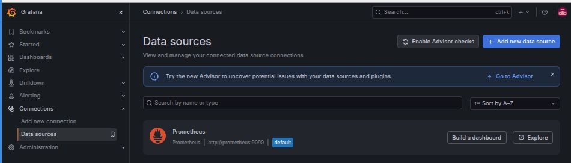
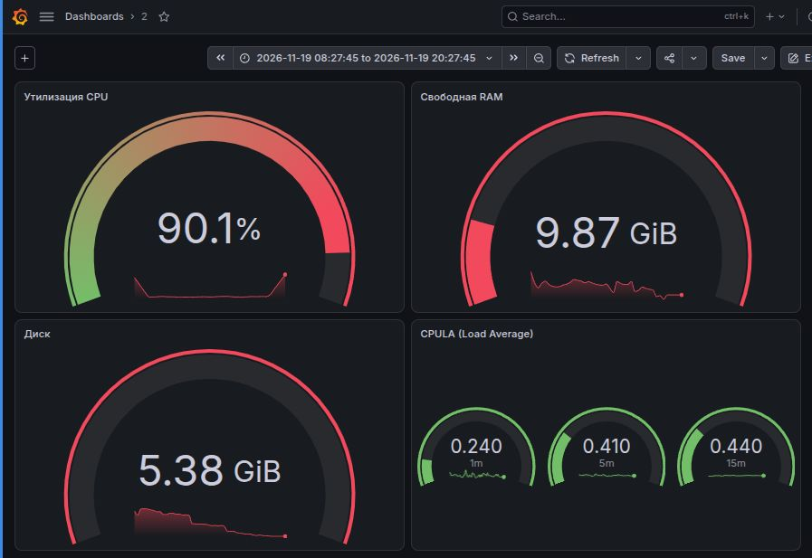
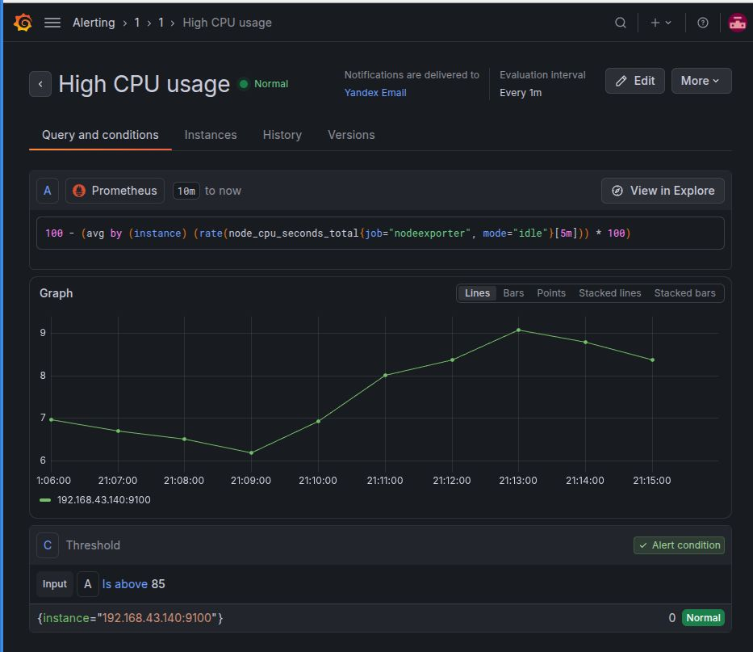
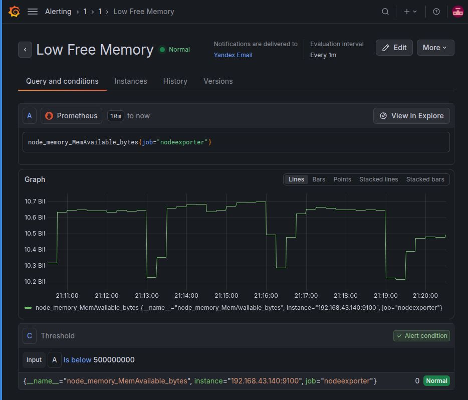
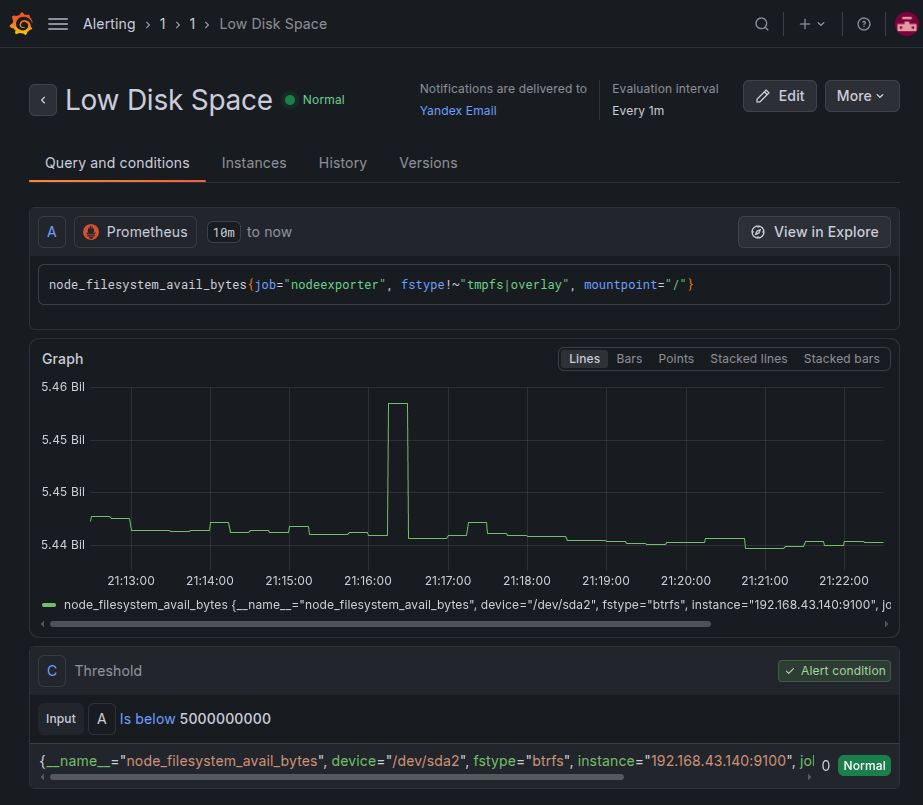
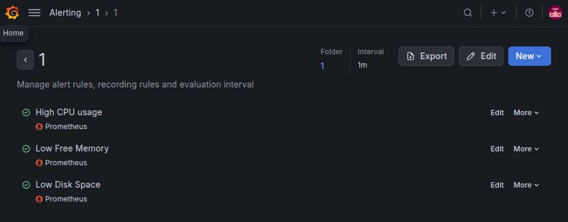
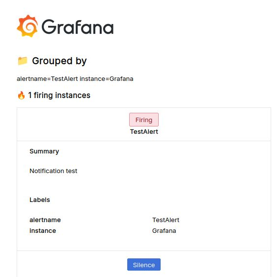

# Домашнее задание к занятию «Средство визуализации Grafana» - Никифоров Роман Сергеевич

Задание повышенной сложности

При решении задания 1 не используйте директорию help для сборки проекта. Самостоятельно разверните grafana, где в роли источника данных будет выступать prometheus, а сборщиком данных будет node-exporter:

    grafana;
    prometheus-server;
    prometheus node-exporter.

За дополнительными материалами можете обратиться в официальную документацию grafana и prometheus.

В решении к домашнему заданию также приведите все конфигурации, скрипты, манифесты, которые вы использовали в процессе решения задания.

При решении задания 3 вы должны самостоятельно завести удобный для вас канал нотификации, например, Telegram или email, и отправить туда тестовые события.

В решении приведите скриншоты тестовых событий из каналов нотификаций.
Обязательные задания
Задание 1

    Используя директорию help внутри этого домашнего задания, запустите связку prometheus-grafana.
    Зайдите в веб-интерфейс grafana, используя авторизационные данные, указанные в манифесте docker-compose.
    Подключите поднятый вами prometheus, как источник данных.
    Решение домашнего задания — скриншот веб-интерфейса grafana со списком подключенных Datasource.

Задание 2

Изучите самостоятельно ресурсы:

    PromQL tutorial for beginners and humans.
    Understanding Machine CPU usage.
    Introduction to PromQL, the Prometheus query language.

Создайте Dashboard и в ней создайте Panels:

    утилизация CPU для nodeexporter (в процентах, 100-idle);
    CPULA 1/5/15;
    количество свободной оперативной памяти;
    количество места на файловой системе.

Для решения этого задания приведите promql-запросы для выдачи этих метрик, а также скриншот получившейся Dashboard.
Задание 3

    Создайте для каждой Dashboard подходящее правило alert — можно обратиться к первой лекции в блоке «Мониторинг».
    В качестве решения задания приведите скриншот вашей итоговой Dashboard.

Задание 4

    Сохраните ваш Dashboard.Для этого перейдите в настройки Dashboard, выберите в боковом меню «JSON MODEL». Далее скопируйте отображаемое json-содержимое в отдельный файл и сохраните его.
    В качестве решения задания приведите листинг этого файла.

Как оформить решение задания

Выполненное домашнее задание пришлите в виде ссылки на .md-файл в вашем репозитории.

------

  Задание 1.
  
  [docker-compose.yml](docker-compose.yml)
  
  [prometheus/prometheus.yml](prometheus/prometheus.yml)
  
  [grafana/provisioning/datasources/prometheus.yml](grafana/provisioning/datasources/prometheus.yml)
  
  [grafana/provisioning/dashboards/dashboards.yaml](grafana/provisioning/dashboards/dashboards.yaml)
  
  
  
------

  Задание 2.

  

------

  Задание 3.
  
  [grafana/provisioning/alerting/alert-rules.yaml](grafana/provisioning/alerting/alert-rules.yaml)

  
  
  
  
  
  
  
  
  

------

  Задание 4.
  
  [dashboards/node-exporter-dashboard.json](dashboards/node-exporter-dashboard.json)
   
------
